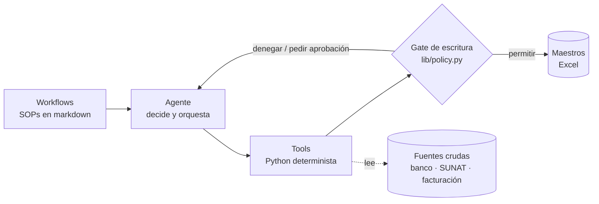

# Control financiero con agentes — núcleo determinista

Extracto de un sistema privado que lleva el control financiero mensual de un grupo de dos
empresas peruanas de servicios: conciliación bancaria, detracciones (SPOT), cruce tributario
con SUNAT y cuentas por cobrar. Un agente de IA orquesta el cierre; **el código de este repo es
la parte que no se le deja al modelo**.

> Todos los nombres, RUC, cuentas e importes son **ficticios**. El sistema completo y sus datos
> son privados; aquí está el núcleo genérico, con sus tests.

## La idea

Si cada paso de un proceso es 90% exacto, tras cinco pasos quedas en 59%. Por eso el trabajo se
reparte en tres capas:



- **Workflows**: qué hacer y cuándo, en lenguaje plano.
- **Agente**: lee el workflow, elige el tool, maneja fallos y pregunta cuando falta información.
- **Tools**: cálculo, parseo y escritura. Deterministas y testeados.

Las reglas de seguridad no viven en el prompt. Viven en código que el agente no puede saltarse.

## Qué hay aquí

| Pieza | Archivo | Qué resuelve |
|---|---|---|
| Gate de escritura | `tools/lib/policy.py` | Siete checks deterministas antes de tocar un maestro: entidad, capacidad ↔ archivo, periodo abierto, respaldo previo, umbral de monto, evidencia citada y simulación por defecto. Todo intento queda en un log append-only. |
| Sello de integridad | `tools/lib/sellos.py`, `tools/sellar_mes.py` | Huella sha256 de los números del banco de cada mes cerrado. La clasificación puede cambiar; los números no, sin que se note. |
| Compuerta de ingesta | `tools/validar_ingesta.py` | Valida el contenido de cada fuente antes de calcular nada: periodo real, cobertura hasta el corte, formato, identidad de la empresa. |
| Traspasos internos | `tools/lib/operaciones.py`, `tools/cruzar_operaciones.py` | Une las dos patas de un traspaso por el número de operación del banco. Nunca suma monedas distintas. |
| Detracciones (SPOT) | `tools/detalle_detracciones.py`, `tools/integrar_detracciones.py`, `tools/lib/constancias.py` | Factura por factura: quién debe depositar el 12%, si ya entró y con qué constancia. Los casos ambiguos se proponen, nunca se cierran solos. |
| Tributario | `tools/lib/sire.py`, `tools/lib/sire_txt.py`, `tools/ingerir_sire_txt.py`, `tools/incorporar_rvie.py`, `tools/cruzar_tributos.py` | Lee los libros oficiales de SUNAT (RVIE/RCE) y los cruza contra los maestros y el banco. |
| Comprobantes | `tools/lib/comprobantes.py` | Parser de XML UBL 2.1 y de recibos por honorarios en PDF. |
| Identidad de pagadores | `tools/lib/identidad.py` | Decide si una glosa bancaria truncada nombra a un cliente, derivando de la cartera qué palabras identifican y cuáles son genéricas. |
| Extractos | `tools/scrape/bcp_empresas.py`, `tools/scrape/banco_nacion.py` | Parsers de los exports de los bancos (csv, txt con pipe, xlsx, xls BIFF). |
| Soporte | `tools/lib/cierre.py`, `sources.py`, `formato.py`, `env.py`, `empresas.py`, `clientes.py` | Config por mes, resolución de rutas, formato, datos maestros. |

## Decisiones de diseño

- **Denegar por defecto.** Un archivo que el mapa de capacidades no cubre no se escribe.
- **La frontera es el archivo, no la identidad declarada.** Nada obliga a un modelo a decir la
  verdad sobre quién es; sí se puede saber qué archivo está a punto de escribir.
- **Sin `--aplicar` no se escribe.** Toda corrida es una simulación hasta que se pida lo contrario.
- **Nunca cerrar por adivinar.** Un cruce por importe con dos candidatos se marca ambiguo y lo
  decide una persona. Una nota de crédito sin documento de destino no se aplica por monto.
- **Lo descartado se devuelve.** Un descarte invisible es un hueco que nadie audita.
- **Los tests nombran el caso que los motivó**, para que nadie los borre por redundantes.

## Correr los tests

```bash
python -m venv .venv && source .venv/bin/activate
pip install -r requirements.txt
python -m pytest tests/ -q
```

188 tests, todos con datos sintéticos en directorios temporales.

## Qué no incluye

El sistema del que sale este extracto tiene más piezas: el orquestador del cierre, la
conciliación completa, cobranzas, flujo de caja, los sub-agentes y sus workflows. No están
aquí porque están atados a datos reales. Algunos docstrings mencionan esos módulos para explicar
una decisión; la capa de datos (carpetas `01.`–`08.`) tampoco se versiona.

## Autor

Edson Palomino — [github.com/edpauce](https://github.com/edpauce)

Código publicado como muestra de trabajo. Todos los derechos reservados.
