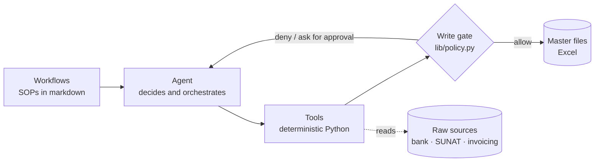

# Agent-driven financial control — deterministic core

An extract from a private system that runs the monthly financial close of a group of two
Peruvian service companies: bank reconciliation, tax withholdings (SPOT), tax cross-checks
against SUNAT (Peru's tax authority) and accounts receivable. An AI agent orchestrates the
close; **the code in this repo is the part that is never left to the model**.

> All names, tax IDs (RUC), accounts and amounts are **fictitious**. The full system and its
> data are private; this is the generic core, with its tests.

## The idea

If every step of a process is 90% accurate, after five steps you are at 59%. That is why the
work is split into three layers:



- **Workflows**: what to do and when, in plain language.
- **Agent**: reads the workflow, picks the tool, handles failures and asks when information is missing.
- **Tools**: calculation, parsing and writing. Deterministic and tested.

Safety rules don't live in the prompt. They live in code the agent cannot bypass.

## What's here

| Piece | File | What it solves |
|---|---|---|
| Write gate | `tools/lib/policy.py` | Seven deterministic checks before touching a master file: entity, capability ↔ file, open period, prior backup, amount threshold, cited evidence and dry-run by default. Every attempt is recorded in an append-only log. |
| Integrity seal | `tools/lib/sellos.py`, `tools/sellar_mes.py` | A sha256 fingerprint of each closed month's bank figures. The classification may change; the numbers cannot change unnoticed. |
| Intake gate | `tools/validar_ingesta.py` | Validates the content of every source before calculating anything: actual period, coverage up to the cut-off date, format, company identity. |
| Internal transfers | `tools/lib/operaciones.py`, `tools/cruzar_operaciones.py` | Joins both legs of a transfer by the bank's operation number. Never adds up different currencies. |
| Withholdings (SPOT) | `tools/detalle_detracciones.py`, `tools/integrar_detracciones.py`, `tools/lib/constancias.py` | Invoice by invoice: who must deposit the 12%, whether it has arrived and with which receipt. Ambiguous cases are proposed, never closed automatically. |
| Tax | `tools/lib/sire.py`, `tools/lib/sire_txt.py`, `tools/ingerir_sire_txt.py`, `tools/incorporar_rvie.py`, `tools/cruzar_tributos.py` | Reads SUNAT's official sales and purchase ledgers (RVIE/RCE) and cross-checks them against the master files and the bank. |
| Receipts | `tools/lib/comprobantes.py` | Parser for UBL 2.1 XML invoices and for professional-fee receipts in PDF. |
| Payer identity | `tools/lib/identidad.py` | Decides whether a truncated bank memo names a client, deriving from the portfolio which words identify a client and which are generic. |
| Statements | `tools/scrape/bcp_empresas.py`, `tools/scrape/banco_nacion.py` | Parsers for the banks' exports (csv, pipe-delimited txt, xlsx, BIFF xls). |
| Support | `tools/lib/cierre.py`, `sources.py`, `formato.py`, `env.py`, `empresas.py`, `clientes.py` | Monthly config, path resolution, formatting, master data. |

## Design decisions

- **Deny by default.** A file not covered by the capability map is not written.
- **The boundary is the file, not the declared identity.** Nothing forces a model to tell the
  truth about who it is; you can, however, know which file it is about to write.
- **No `--aplicar`, no write.** Every run is a simulation unless told otherwise.
- **Never close on a guess.** An amount match with two candidates is marked ambiguous and a
  person decides. A credit note without a target document is not applied by amount.
- **What is discarded is returned.** An invisible discard is a gap nobody audits.
- **Tests name the case that motivated them**, so nobody deletes them as redundant.

## Running the tests

```bash
python -m venv .venv && source .venv/bin/activate
pip install -r requirements.txt
python -m pytest tests/ -q
```

188 tests, all with synthetic data in temporary directories.

## What's not included

The system this extract comes from has more pieces: the close orchestrator, the full
reconciliation, collections, cash flow, the sub-agents and their workflows. They are not here
because they are tied to real data. Some docstrings mention those modules to explain a
decision; the data layer (folders `01.`–`08.`) is not versioned either.

Code identifiers and docstrings are in Spanish, as in the original system.

## Author

Edson Palomino — [github.com/edpauce](https://github.com/edpauce)

[MIT](LICENSE) license.

---

*Versión en español: [README.es.md](README.es.md)*
